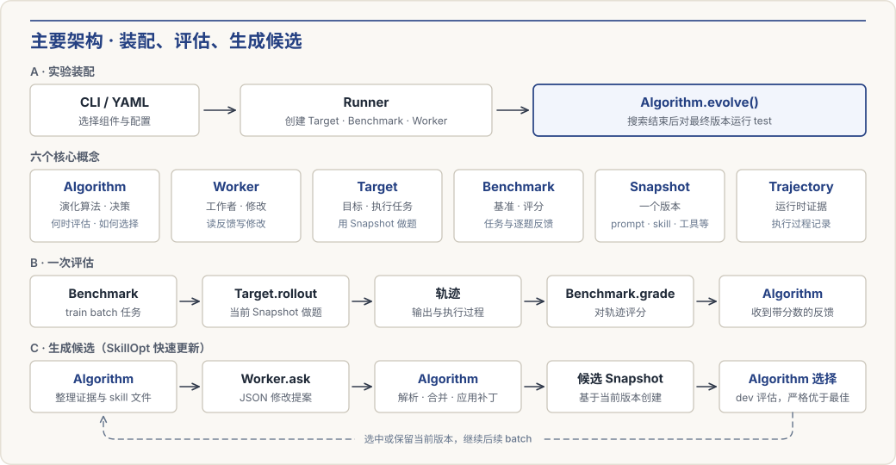
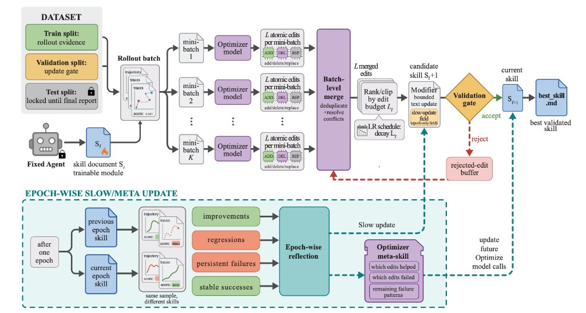
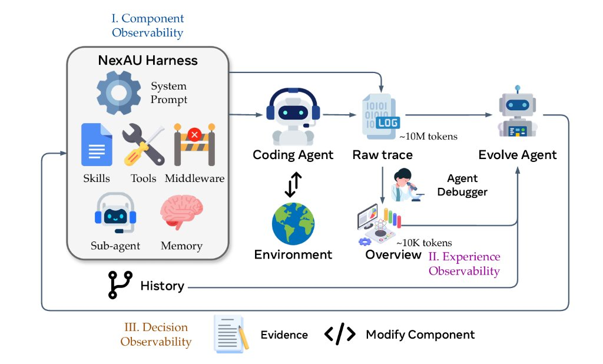
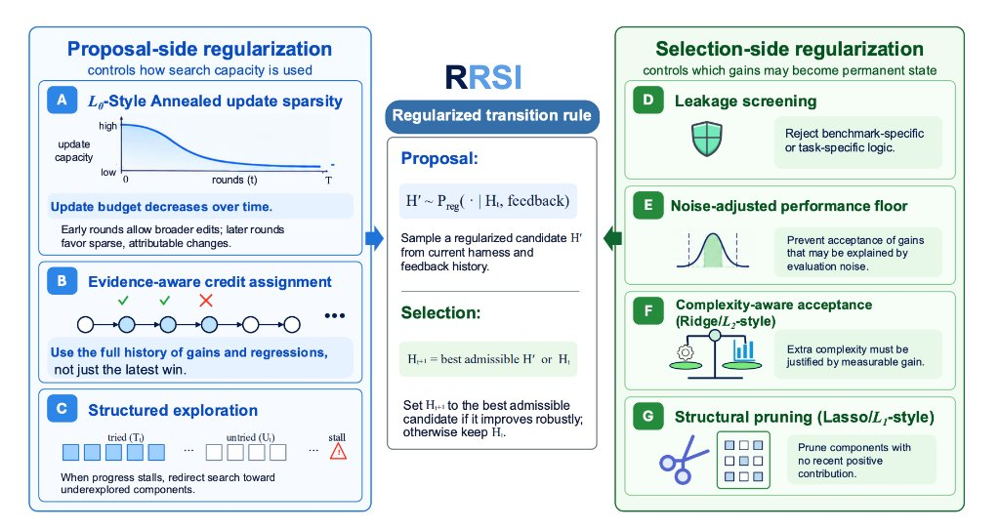
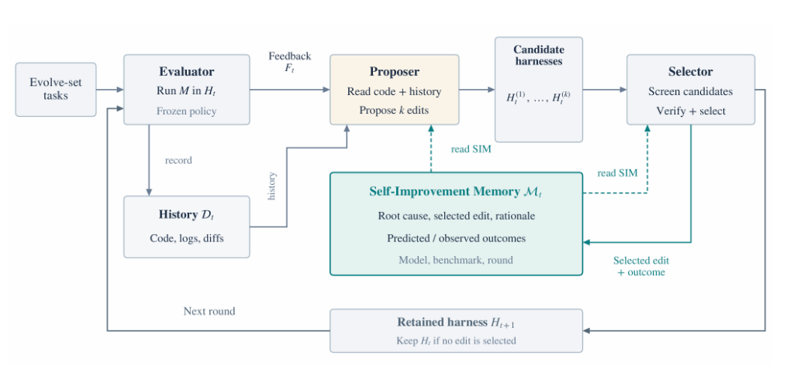

## 一、Harness RSI

**RSI:** 泛指系统能在反馈闭环里不靠人工持续变好；按改进作用的对象划分，当前 RSI 实践主要分为三个方向：

| 演化方向                           | 改进对象             | 典型做法                                                                          | 特点与边界                                   |
| ---------------------------------- | -------------------- | --------------------------------------------------------------------------------- | -------------------------------------------- |
| **Model 层（模型权重）**     | 底层神经网络参数     | 自我训练（Self-training）、自我对弈（Self-play）、可验证奖励强化学习              | 能力上限高，但训练成本与遗忘风险大           |
| **Harness 层（运行外壳）**   | 包裹模型的外围系统   | 冻结模型权重，迭代优化 Prompt、技能、工具、上下文管理与控制流                     | 迭代快、性价比高，是当前的主要研究方向       |
| **Artifacts 层（交付产物）** | 具体任务的产出物本身 | 通过“生成 → 测试验证 → 修正”闭环优化算法代码、算子或方案（如*AlphaEvolve*） | 直接产生可验收成果，但优化结果多绑定具体任务 |

本文讲述 直接决定 Agent 表现的 **Harness 层**。

### 为什么先做 Harness RSI

Lilian Weng（翁荔）在《*Harness Engineering for Self-Improvement*》中说：近期 RSI 不太可能从模型直接改写自身权重开始，更现实的路径是先在 **Harness 层** 跑出规模化收益。

* **优化 Harness 本身能显著降本**：几轮 Harness 迭代就能将推理成本最多降低 60%，靠把上下文管理得更合理、让多 Agent 协作更流畅等，而不是靠拉长模型的推理链条。
* **对大规模部署的中间档模型受益**：Lin 等（2026）将“提出有效改动的能力（*harness-updating*）”与“用好新 Harness 的能力（*harness-benefit*）”拆开评测，发现从 Qwen3-32B 到 Claude Opus 4.6，**不同规模模型提出改动建议的能力几乎持平**、波动很小；但“能否把新 Harness 用出收益”呈非单调分布——弱模型容易卡在未加载或执行出错，强模型已逼近任务上限，反而是 GPT-OSS-120B、Qwen3-235B 这类中间档位模型获益最大。

:::tip[Harness RSI 为什么划算]
**负责提修改建议的优化器不必依赖最昂贵的旗舰模型，可以使用中等主力模型。**
:::

### Harness RSI 具体改什么

**模型**提供推理与生成能力；**Agent Harness** 决定模型看到什么上下文、能调什么工具、出错怎么重试、何时算做完。

传统靠人工读日志、手工改 Prompt 或控制流，不仅耗时，也很难规模化。

**Harness RSI**，就是让系统基于真实执行结果，自己诊断、修改并验证这套由文本、配置和代码构成的 Harness。

当模型权重保持冻结，Harness RSI 修改的内容主要落在以下五类资源上：

| 可改资源                   | 典型问题                               | 对应的改进方式                           |
| -------------------------- | -------------------------------------- | ---------------------------------------- |
| **指令（Prompt）**   | 目标含糊，输出格式或业务约束被忽略     | 重写规则、补齐步骤、收紧约束             |
| **技能（Skill）**    | 某类子任务反复踩同一个坑               | 沉淀可复用的操作流程、核验方法与适用条件 |
| **工具（Tool）**     | 动作接口难用、说明不清，或缺少必要能力 | 修改工具实现、工具描述或调用约定         |
| **执行代码（Code）** | 上下文截断、重试策略或终止判断不合理   | 改写运行循环、观察压缩、状态保留与控制流 |
| **配置（Config）**   | 运行参数、钩子或扩展设置与任务不匹配   | 调整允许修改的执行参数、Hook 与插件配置  |

---

## 二、Harness RSI 组件

一套完整的 Harness RSI 系统，通常由以下六个角色组成：

|               组件               | 一句话职责                                         | 经典论文中的典型形态                                                                                                            |
| :------------------------------: | -------------------------------------------------- | ------------------------------------------------------------------------------------------------------------------------------- |
| **执行 Agent（Executor）** | 挂载当前 Harness 跑任务，产出结果与执行轨迹        | *OPRO* 的 Task LLM、*Harness²* / *RRSI* 中权重冻结的策略模型、*DGM* 中被测的编程 Agent                                 |
|  **诊断器（Diagnoser）**  | 把分数和长轨迹翻译成“错在哪、为什么错”的归因信号 | *Reflexion* 的语言反思、*TextGrad* 的文本梯度反馈、*GEPA* 的轨迹反思、*AHE* 的逐题 Debugger、*RRSI* 的 Critic         |
|   **提案器（Proposer）**   | 基于诊断或历史经验，产出下一版候选修改             | *OPRO* 的 Optimizer LLM、*AlphaEvolve* 的模型集成代码变异器、*DGM* 的自修改引擎、*Meta-Harness* 的 Agentic 编程提案器   |
|  **评估器（Evaluator）**  | 在真实或沙箱环境中客观度量候选版本的表现           | *AlphaEvolve* 的自动化评测脚本与性能分析器、*DGM* 的 SWE-bench 沙箱、*Harness²* 不依赖标准答案的行为对照 Probe           |
|   **选择器 (Selector)**   | 决定谁能留下来、谁能成为下一轮修改起点             | *EvoPrompt* 的种群淘汰、*GEPA* 的逐题 Pareto 前沿、*DarwinX* 的能力保留契约、*RRSI* 兼顾噪声带与 Token 成本的 Pruner    |
|     **记忆（Memory）**     | 跨轮保存历史版本、实测表现、失败教训与修改理由     | *ADAS* / *DGM* 的开放式设计档案、Google *CRSI* 提出的自改进记忆（SIM）、*Meta-Harness* 的文件化历史、*Arbor* 的假设树 |

**诊断器的作用**：如果只有“评估器打一个总分 + 提案器盲改”，系统很快就会在离散搜索空间里原地打转——这也是早期黑盒提示优化的瓶颈。*TextGrad*、*GEPA*、*AHE* 引入轨迹级诊断，本质是把“标量信号”升级成“可定位到具体步骤的语义信号”。

**Memory的作用：** 如果只保留“当前最好版本的代码”，不记录“之前为什么改、哪些尝试失败了、在什么条件下生效”，系统不仅会反复提出已经证伪的补丁，换一个数据集或换一个基座模型时还根本不知道旧改动该留还是该删。Google 在 *CRSI* 论文中提出的 **Self-Improvement Memory（SIM）**，专门针对这个问题：它把“问题归类、修改理由、预期与实测结果、评估上下文”记录下来，给予selector&Proposer查阅，而不是每次都失忆重来。

---

## 三、Harness RSI 循环

循环: “系统到底在进化什么”。Harness RSI 可以分成 **L0、L1、L2** 三个层级：

| 层级                         | 最终目标                               | 更新对象                             | 常见问题                                       |
| ---------------------------- | -------------------------------------- | ------------------------------------ | ---------------------------------------------- |
| **L0：单题解演化**     | 帮**当前这一道题**找到最优解     | 这道题的session、候选代码或解题方案  | 成果绑在单道题上，换题就得重来，受随机性影响大 |
| **L1：任务求解器演化** | 帮**一类任务**练出更强的 Agent   | 指令、技能、工具、执行代码及搜索历史 | 容易对少数题过拟合，新改动破坏已有能力         |
| **L2：改进器自身演化** | 让“**负责改进的机制**”自己变强 | 诊断方式、提案策略、自改进记忆等     | 设计复杂，没有好门禁时很难稳定出收益           |

### L1 的标准运行骨架

```text
1. 选起点（Select Base）   → 从当前版本、历史最佳、候选池或档案中挑出本轮修改基线
2. 跑任务（Execute）       → 执行 Agent 挂载该版本跑样本，收集答案、分数与完整轨迹
3. 做诊断（Diagnose）      → 诊断器分析失败案例、同题成败差异或历史记录，提炼病因
4. 提修改（Propose）       → 提案器产出新指令、结构化补丁或多文件代码改动
5. 过验证（Evaluate/Gate） → 评估器在验证集或对照任务上测量候选，核对门禁
6. 留状态（Select/Record） → 选择器决定接纳、拒绝或归档，把新版本与教训写回记忆
```

---

## 四、RSI 框架

### 4.1 背景：为什么 RSI 结果很难直接比

打开两篇 RSI 论文，A 说自己在 SWE-bench 上涨了 12 个点，B 说自己在多跳问答上涨了 15 个点。这两个数字几乎没法横向对比，它们可能同时换了**基座模型、Agent 框架、任务数据集**。最后看到的涨分，到底来自算法，更强的 Worker 模型、还是多跑了 Rollout，根本说不清。

**FlashRSI** 要解决的就是这件事。它把一次 RSI 实验拆成三个可以独立替换的模块：

```text
一次实验 = RSI 算法（Algorithm） × Agent 框架（Harness） × 评测任务（Benchmark）
```

只要把三者接到同一套接口上，就能固定 Agent 框架和评测任务，专门对比不同算法在相同起点的真实表现。

### 4.2 角色

|  FlashRSI 核心对象  |     承接的 RSI 角色     | 代码中的实际职责                                                                                                     |
| :-----------------: | :----------------------: | -------------------------------------------------------------------------------------------------------------------- |
|  **Target**  |      任务执行 Agent      | 挂载指定 `Harness Snapshot` 运行任务，通过 `rollout()` 返回 `Trajectory`；只有调用 `update()` 才切换默认版本 |
|  **Worker**  |     诊断器 + 提案器     | 通过 `ask()` 输出文本/JSON 提案，或通过 `edit()` 直接修改检出目录；模型与凭据完全独立于 Target                   |
| **Algorithm** | 搜索策略 + 选择器 + 记忆 | 声明读写范围，在 `evolve()` 里全权负责组织证据、调用 Worker、管理档案、执行准入并返回最终版本                      |
| **Snapshot** |      不可变版本载体      | 封装 Harness 声明的完整资源树、组件规则、SHA-256 内容标识与父子谱系                                                  |
| **Benchmark** |     任务源 + 评估器     | 通过 `load()` 提供 `train / dev / test` 划分，通过 `grade()` 给轨迹补齐主指标并封装为 `Results`              |
|  **Runner**  |    实验总控与审计记录    | 解析 YAML/CLI 配置、组装角色、绑定任务环境、落盘记录，并在搜索结束后统一在 `test` 上评估选定版本                   |

### 4.3 Snapshot

做 RSI 实验必须能回答：**这个评测结果，到底是哪一份提示词、技能和代码（哪个版本的Harness）跑出来的？** 如果只存零散的 diff 或改写建议，无法复现当时的真实行为。

FlashRSI 使用 **Snapshot **。它是一份**不可变、内容寻址的单文件 JSON。**

* Snapshot 内容：通过 `components.yaml` 声明纳入版本的全部文件（Base64 编码字节、组件标签、可执行位）、`component_rules`、`agent_type`，以及 `root_id` 与 `parent_id`。

每个 Harness 先用 `components.yaml` 声明自己愿意暴露哪些资源。

```yaml
# MiniAgent：干净开源，直接暴露运行时代码
code:   [runtime/**, middleware/**, sub_agents/**]
skill:  [skills/**]
prompt: [prompts/**]
tool:   [tools/**, tool_descriptions/**]
config: [agent.yaml]
```

```yaml
# Claude Code：闭源 SDK，只暴露稳定扩展接口（没有 code 组件）
prompt: [CLAUDE.md, output-styles/**]
skill:  [skills/**, commands/**]
agent:  [agents/**]
hook:   [hooks/**]
tool:   [.mcp.json, .lsp.json, servers/**]
config: [.claude-plugin/plugin.json, settings.json]
```

然后，每个 RSI 算法再声明自己的读写范围：比如 SkillAdam 只声明 `{"skill"}`，AHE 声明 `{"*"}`（表示当前 Target 暴露了哪些它就都能改)。

* **修改时（局部放行）**：算法调用 `snapshot.check_out()` 给 Worker 准备临时工作目录时，放出被允许看和改的那几个文件，防止误改。
* **评测时（完整执行）**：Worker 改完后，框架将改动与未改文件合并生成新的 Snapshot；Target 跑任务时，始终把新 Snapshot 的全部文件还原出来执行，测出整体真实表现。

### 4.4 Harness 接入

|              如何接入              |                Harness                | 具体做法                                                                                                                                 |                                                                       修改范围/注意事项                                                                       |
| :--------------------------------: | :-----------------------------------: | ---------------------------------------------------------------------------------------------------------------------------------------- | :-----------------------------------------------------------------------------------------------------------------------------------------------------------: |
|      **直接用原版代码**      |        MiniAgent、JiuwenSwarm        | 本身就是纯 Python，直接把原文件收进 Snapshot 打上标签，跑的时候直接加载（JiuwenSwarm 只做 Target）                                       |                                                                代码、提示词、技能、工具都能改                                                                |
|        **接官方 SDK**        |              Claude Code              | 通过官方 Agent SDK 调起，闭源主循环留在官方那边，Snapshot 只管官方开放出来的外围配置                                                     |                                 只能改 `CLAUDE.md`、skills、hooks、MCP/LSP 和 settings，**改不了闭源产品内部的行为**                                 |
| **用 Python 自己重写核心版** | Codex、Pi、Hermes、OpenClaw、OpenCode | 很多原版依赖不是 Python 写的（如 Rust / Node / Bun CLI），FlashRSI 锁死某个上游版本，自己用纯 Python 重写它的无界面核心循环装进 Snapshot | 重写后的核心代码和资源都能做版本管理并演化，但**只是精简版本**（如 Codex 没覆盖 WebSocket、HTTP/OAuth MCP 和完整执行策略；Pi 只对齐 v1.4.0 无界面循环） |

### 4.5 流程



把 14 种算法放在 `flashrsi/core/algorithm.py` 的公共基类上拆解，一次演化共用六步基础操作：

|     步骤     | 做什么                                                            | 谁做决定             |
| :-----------: | ----------------------------------------------------------------- | -------------------- |
|   1. 选起点   | 当前版本、历史最佳、候选池成员，或每次回到初始 `seed`           | Algorithm            |
|  2. 组织反馈  | 分数、失败轨迹、源码文件、历史经验或上一轮判决                    | Algorithm            |
|  3. 产生修改  | `worker.ask()` 返回文本/补丁，或 `worker.edit()` 改目录       | Worker               |
|  4. 提交候选  | 校验路径、组件权限与凭据，生成不可变 Snapshot                     | Snapshot + Algorithm |
| 5. 执行与评分 | 在指定任务上运行完整候选，经 `Benchmark.grade()` 得 `Results` | Target + Benchmark   |
|  6. 更新状态  | 接纳、拒绝、入档、写记忆，或调整下一轮预算/策略                   | Algorithm            |

为了公平对比，FlashRSI 在框架层的三条规则：

1. **Harness 资源与 Benchmark 环境彻底隔离。** `runner.py` 绑定完 Benchmark 集成后，会强制校验 `target.snapshot.id == selected`——如果某个任务集成偷偷替换了 Harness 版本，启动直接报错。Harness 从 `files_dir` 读自己的版本，通过 `working_dir` 操作任务，两者绝不混在一起。
2. **容器隔离与宿主机评分。** 已接入的纯文本任务（SearchQA、HotpotQA context、MATH 等）通过 `supplied_context` 在每题独立的 Docker 容器里跑 Target，只挂载公开题目和选中 Snapshot，容器网络只放行模型端点；原始标注、评分器、Judge 和用户模拟器全部留在宿主机，防止 Agent 偷看答案或历史目录。
3. **评测集划分 `train / dev / test` 。**
   * `train` 产生训练轨迹与诊断证据（OPRO、AHE、DarwinX、ModularRSI、RRSI 甚至直接用 train 评分选优）；
   * `dev` 用于筛选和比较候选（一旦反复参与选择，它就已是搜索集，不再是独立泛化证明）；
   * `test` 留给 `Runner` 在搜索结束后统一评一次。`flashrsi run` 结束时只评最终选中的版本，不会自动补评初始版本。

### 4.6 示例：一道实体混淆题，怎样变成可复用技能

题目：“RSI项目由小明负责协调，小明在杭州工作；小红在成都负责协调项目”，问题问：RSI项目的协调员在哪个城市工作。

假设初始版本 `S0` 受干扰实体影响，错答了 `成都`。用教学视角走一遍 SkillOpt 的流程：

1. **定基线**：初始指令、工具和技能组成 `S0`，先在 3 道 `dev` 题上测出基准分。
2. **跑训练**：用 `S0` 跑本批 `train` 题，拿到轨迹与得分（`demo-01` 失败）。
3. **做诊断**：Worker 看到轨迹，归因是“多跳实体关系追踪不完整，误用了邻近干扰人物的城市”。
4. **提有界补丁**：Worker 按 JSON 协议提出一条针对 `skill` 组件的修改，写入通用核验规则：
   ```text
   多跳实体核验：先锁定问题主体，逐条追踪关联关系；
   引用最终属性前，确认该属性明确归属于已锁定实体，排除邻近干扰项。
   ```
5. **完整物化测候选**：提交新技能形成 `S1`（其余 Prompt、工具和代码不变），在完整 `dev` 上重测。
6. **过门禁**：SkillOpt 要求 `dev` 均分严格提升才调用 `target.update(S1)`；同分或下降就保留 `S0`，并把被拒补丁记进拒绝缓冲，提醒下一轮别重踩。
7. **考未见题**：搜索结束，Runner 用最终选定的版本跑 3 道 `test` 题，检验规则是真学会了“防实体混淆”，还是只背下了 `杭州`。

## 五、RSI 算法

### 5.1 FlashRSI适配14种RSI算法

rsi算法主要差别：**改什么资源、给 Worker 看什么证据、用什么数据结构记历史、按什么规则留下新版本。**

| 分组                         | 算法                   | 一句话核心思想                                          | FlashRSI 实际改什么     | 跨轮维护的核心状态                                         | 保留与最终输出规则                                                        |
| ---------------------------- | ---------------------- | ------------------------------------------------------- | ----------------------- | ---------------------------------------------------------- | ------------------------------------------------------------------------- |
| 指令                         | **OPRO**         | 把历史“指令—分数”曲线喂给模型做黑盒提案              | 单个指令文件            | 全部已测指令与 train 分数、`_leader`                     | 已测全入历史；最终取 train 最高分                                         |
| 指令                         | **EvoPrompt**    | LLM 做自然语言交叉/变异，GA 或 DE 管淘汰                | 单个指令文件            | 固定大小种群、跨代全局 `best`                            | GA 整代选幸存者，DE 逐位严格替换；最终取跨代 dev 最佳                     |
| 指令                         | **GEPA**         | 轨迹反思改指令，逐题 Pareto 前沿保留互补探索方向        | 单个指令文件            | 持续追加的候选池、逐题 dev 分数、父索引                    | train 小批次过筛后测完整 dev 即入池；最终取池中 dev 均分最高              |
| 指令                         | **ACE**          | 用增量 Playbook 条目避免整段重写丢经验                  | 指令文件的受管后缀      | 条目、helpful/harmful 计数、拒绝记录                       | 合法更新立即采用；offline 取测得 dev 最佳，online 返回末版                |
| 技能与经验                   | **SkillOpt**     | 有界补丁 + 拒绝反馈 + 跨 epoch 慢整理与元技能           | `skill` 组件文本文件  | 当前技能、拒绝补丁缓冲、上轮 epoch 版本、`meta-skill`    | 快慢资源候选均须严格提升 dev；返回最后接受版本                            |
| 技能与经验                   | **SkillAdam**    | 问题记忆稳方向，逐题分差波动调编辑预算                  | 单个已有 `.md` 技能   | `issue memory`、逐题分差方差 EMA、dev 基线               | 严格提升 dev 才更新技能；被拒尝试仍更新记忆与方差                         |
| 技能与经验                   | **Evo-Harness**  | 单次任务流失败经验，编译成两级原生技能目录              | 原生 `skills/` 目录   | 当前技能库、本批失败经验                                   | Topic / General 合法即采用，无 dev 门槛；返回流结束末版                   |
| 完整 Harness（迭代/档案）    | **ADAS**         | 用设计说明与分数组成的档案，探索 Agent 结构             | 全部已声明组件（`*`） | 设计档案（`name/thought/fitness`）、`best`             | 从 `best` 检出并评前复查，全入档；最终取 dev 最佳                       |
| 完整 Harness（迭代/档案）    | **Meta-Harness** | 把完整历史源码与轨迹放进文件系统，让提案 Agent 自己找   | 全部已声明组件（`*`） | `seed`、历代源码与轨迹、`best`                         | 每次从 `seed` 检出，Worker 自由复用历史；最终取 dev 最佳                |
| 完整 Harness（迭代/档案）    | **AHE**          | 每次改动必须附带可核对的效果预测清单                    | 全部已声明组件（`*`） | `current`、上轮判决、回滚原文、拒绝记录                  | 合法且测完的候选全部留作 `current`（含降分）；返回最后保留版            |
| 完整 Harness（约束/模块/树） | **DarwinX**      | 保住已有能力再扩展，并从落选分支中重组互补能力          | 全部已声明组件（`*`） | 全量档案、已准入父池、能力保留集 `invariant`             | 小样本筛选 + 重复全量确认决定准入；最终取已准入者最高存档 train 分        |
| 完整 Harness（约束/模块/树） | **ModularRSI**   | 按功能模块限定文件，用同题成败对照独立演化再集成        | `modules` 映射文件    | 各模块独立分支、同题成功记忆、改动史                       | 文件/语法/完整 diff review/执行门禁决定前进（无涨分门槛）；按回退规则输出 |
| 完整 Harness（约束/模块/树） | **RRSI**         | 提案侧收缩机制预算，选择侧卡噪声带与 Token 成本         | 全部已声明组件（`*`） | `incumbent`、历史最高分 `S*`、噪声带 `delta`、编辑史 | 先判准入，再在合格兄弟中选分数最高者；返回最后接纳版                      |
| 完整 Harness（约束/模块/树） | **Arbor**        | 用假设树管研究方向，实验从 `trunk` 出发，经验向上综合 | 全部已声明组件（`*`） | 假设树（含 `insight`）、当前 `trunk`                   | train 过筛且 dev 严格提升才更新 `trunk`；返回最终 `trunk`             |

### 5.2 五类RSI算法

#### 5.2.1 Prompt演化：OPRO、GEPA

##### OPRO：用历史指令和分数生成下一批指令

* **问题**：自然语言指令是离散文本，既算不了数值梯度，靠人工反复调 Prompt 又费时且难以规模化。
* **怎么解决**：把 LLM 直接当无梯度优化器——将历史试过的“候选指令 + 实测分数”按得分升序拼成 Meta-Prompt，让优化模型顺着上升趋势迭代生成更优指令。

1. **建立历史。** 给定初始指令、训练题和评分规则。任务模型使用初始指令做题，评测器计算训练正确率，记下「指令、分数」。
2. **生成提案。** 给优化器一份元提示词，里面有目标、几道训练题的输入输出示例，以及历史中得分最高的一批指令。展示时把这批指令按分数从低到高排列。优化器每轮提出多条新指令。
3. **评分并更新历史。** 把新指令逐条交给任务模型跑训练题，所得分数连同指令写回历史。下一轮重新从历史挑高分记录。搜索结束后取优化目标上得分最高的指令。

##### GEPA：用轨迹改提示词，用逐题得分选父版本

* **问题**：只靠单一总分反馈，样本效率低且看不清错因；若只从均分最高者继续改，又会过早淘汰在部分题目上有独到优势的策略。
* **怎么解决**：反思完整执行轨迹直接定位病因并提出定向修改，同时维护逐题最优的候选，演化出更优提示词。

**候选怎样进池。**

1. **初始化。** 用整套初始提示词在选择集上跑一遍，记录每题分数，作为候选池的第一个成员，父版本为空。
2. **挑父版本并收集反馈。** 按下表的逐题方法从池中抽父版本，轮流选择要改的模块。用父版本跑反馈集的一小批题，收集该模块的输入、输出、分数和文字反馈。
3. **改一个模块并复跑同批题。** 反思模型读旧提示词和上述证据，产出新提示词。例如，检索模块反复漏掉同名实体的年份，就加一条要求核对年份的指令。复制父版本、替换这一处提示词，再用整套系统跑同一批题。
4. **小批均分严格提高就入池。** 记录新候选及其父版本，并跑完整选择集，存下逐题分数。例如，同一批 3 题从答对 1 题变成答对 2 题即可入池。选择集均分用于以后比较和选优，入池时只看这次小批对照的结果。

| 池中版本  |        题 1 |        题 2 |        题 3 |        题 4 |           均分 | 本轮抽样权重 |
| --------- | ----------: | ----------: | ----------: | ----------: | -------------: | -----------: |
| A（初始） | **1** | **1** |           0 |           0 |           0.50 |            2 |
| B         |           0 | **1** | **1** | **1** | **0.75** |            3 |
| C         |         0.5 |         0.5 |         0.5 |         0.5 |           0.50 |            0 |
| D         |           0 | **1** |           0 |           0 |           0.25 |            0 |

候选：按每道题的最高分（含并列）列出领先集合：`F1 = {A}`、`F2 = {A, B, D}`、`F3 = {B}`、`F4 = {B}`。**C**未进入任何集合。

剪枝：**D**只出现在 `F2`中，但题 2 已有 A、B 覆盖且两人各自另赢他题，删掉 D 不影响任何题的覆盖，因此 D 在抽样时被剔除。

选择：剩余集合摊平为 `[A, A, B, B, B]`（共 5 个席位，A 占 2 席、B 占 3 席），于是 **A、B 分别有 40% 和 60% 的概率被抽为父版本**。注意，C、D 仍留在候选池中不删除；若此刻预算耗尽，则直接返回池中选择集均分最高的 **B**。

---

#### 5.2.2 skill演化：SkillOpt、SkillAdam

##### SkillOpt：

* **问题**：skill大多依赖人工编写，单次生成，或者通过简单的自我修正来调整；缺乏系统性的优化机制，很容器再修改时引入新的错误，或者对特定的错误过拟合。
* **怎么解决**：引入编辑预算、验证门控(只有验证集得分高于当前版本，修改被接纳)、缓存被拒绝的编辑(缓存负反馈，防止错误重复)、慢更新与元学习(每个迭代后，总结出长周期的改进规律，用于指导后续更精细的局部编辑)



|          更新          |                              读什么                              |                   写到哪里                   |
| :---------------------: | :---------------------------------------------------------------: | :------------------------------------------: |
|       每步快更新       |               当前技能跑一批训练题的成功与失败轨迹               |   向求解技能追加、插入、替换或删除少量条目   |
|   每个 epoch 的慢更新   | 用同一批训练题比较上一 epoch 和当前技能，找出改善、退步与持续失败 |       在求解技能的受保护区域写长期指导       |
| 每个 epoch 的元技能更新 |           哪些编辑奏效、哪些被拒绝、哪些问题仍反复出现           | 写给优化器的指导，供后续反思、合并和排序使用 |

##### SkillAdam：

* **问题**：仅靠单批局部反馈迭代技能，容易被局部噪声带偏（方向震荡、覆盖已有有效修正），且固定修改幅度极易越改越乱。
* **怎么解决**：把深度学习 Adam 的思想映射到文本技能演化，用持续更新的 **问题记忆（一阶动量）** 稳住修改方向，用逐题分差波动（**二阶自适应步长**）动态调节每轮编辑预算，显著减少无效试错。

模拟一阶动量：引入“动态问题追逐器"作为优化记忆。负责系统化记录已识别的问题模式、历史尝试过的修复手段和成败状态。每次更新必须结合历史上下文，确保有效经验被持续累积，避免无休止的自我否定与重复踩坑。

模拟二阶方差：引入“基于波动率的编辑预算”作为自适应步长。统计各个案例之间得分改善幅度的样本方差，当各题收益稳定一致时保持较大修改额度，一旦出现“修好几题却弄坏几题”的震荡情况，便自动收紧下一轮允许编辑的条数。

|   四道题目新旧分差   |  平均  |  方差  |                  分析                  |                  下一轮编辑预算怎么变                  |
| :------------------: | :----: | :-----: | :------------------------------------: | :----------------------------------------------------: |
|  `+1, +1, +1, +1`  | `+1` |  `0`  |           收益一致、方向很稳           |            保持宽松（仍可改**4** 处）            |
|    `0, 0, 0, 0`    | `0` |  `0`  |        没提分，但也没引发副作用        |      波动不升，保持**4** 处（允许继续大改）      |
| `+1, −1, +1, −1` | `0` | `4/3` | **拆东墙补西墙**（修两题坏两题） | 波动骤升，预算自动砍半至**2** 处（逼着小步微调） |

---

#### 5.2.3 完整 Harness 演化：AHE

##### AHE：

* **问题**：只改系统提示词很难突破编码 Agent 的能力上限（主要收益来自工具、记忆和中间件等结构组件），但多文件 Harness 一起改时像开盲盒，改完说不清哪处改动修好了哪题、又改坏了哪题。
* **怎么解决**：围绕**组件、经验、决策三类可观测性**闭环演化整个 Harness，将长轨迹蒸馏成诊断证据，并强制每次修改附带可证伪的效果预测清单，下一轮实测逐题核对归因。



组件可观测：不把所有指令揉成一团，而是把 Prompt、工具代码、中间件解耦成独立的文件。每次修改都是明确的、可回滚的文件级操作。

经验可观测：跑长线任务会产生几百万 Token 的流水账日志。AHE 把这些海量日志压缩成带层次的、可下钻深挖的失败归因报告，让优化agent能“看懂”问题在哪。

决策可观测：强迫优化agent每次改Harness时，必须明确预测这次修改能修复哪些具体的测试用例，又有哪些会存在倒退风险。下一个回合直接跑测试验证，预测失败就触发文件级自动回滚。告别 AI 无脑试错。

---

#### 5.2.4 正则化搜索：RRSI

##### RRSI：

* **问题**：无约束的 Harness 自改进极易对训练集过拟合，不断堆砌复杂补丁导致 Token 开销暴涨，换到全新的生成场景，效果立刻下跌。
* **怎么解决**：在不限制可改范围的前提下，同时给**提案侧**和**选择侧**加正则化，提案侧用时间退火收缩机制预算并引导结构化探索；选择侧结合 Critic 审查、分数噪声带与 Token 成本剪枝，兼顾跨任务泛化与推理成本。



**提案侧**：

* 引入类似稀疏惩罚的更新预算机制。在演进初期，允许单次打包多个组件改动来探索解空间；随着迭代轮次增加，使用余弦退火策略逐步缩减单次修改配额，最终强制单次只做局部原子改动。这确保了后期改动的因果归因极度清晰。
* 全历史经验追踪。完整记录历史每一次改动的假设、差异、得分波动与最终去留，被证伪的策略直接作为负向约束，避免搜索反复在死胡同里打转。
* 防停滞探索。若多轮迭代收益都在噪声区间内徘徊，系统会自动将提案预算导向未被探索过的组件类型。

**选择侧**：

* 前置泄漏审查员。在执行全量打分前，通过独立模型审查代码 Diff，直接驳回包含具体任务实体、特定业务逻辑或无效冗余代码的提案，防止硬编码取巧。
* 噪声底线与多条件准入。系统预先测定基线脚手架的评测波动区间，任何改动哪怕省了 Token，只要性能跌穿“历史最佳减去噪声容差”，一律驳回。
* 收益绑定的 Token 成本门禁。类似权重衰减的约束，改动带来的 Token 成本增幅必须有成比例的性能提升来支撑。
* 结构化剪枝机制。类似 L1 稀疏化的逻辑，如果某个模块或工具在固定的观察窗口内持续未能带来正向增益，系统会主动将其标记为待清理对象，剔除冗余。

**举例**：设当前版本分数与成本为 $S, C$，历史最高分为 $S^\star$，基线噪声容差为 $\delta$；候选相对变化为 $\Delta S = S' - S$、$\Delta C = (C' - C)/C$：

| 检查情形                            | 准入条件                                      | 对应作用                                                   |
| :---------------------------------- | :-------------------------------------------- | :--------------------------------------------------------- |
| 所有候选先过底线                    | $S' \ge S^\star - \delta$                   | 防止每轮小退步累积成大退步                                 |
| 明确涨分（$\Delta S > \delta$）   | $\Delta C \le \beta_0 + \beta_1 \Delta S$   | 涨分越多，允许的 Token 成本增幅越大                        |
| 噪声带内（$\Delta S \le \delta$） | $w_s \Delta S - w_c \Delta C + w_n \nu > 0$ | 分数变化在噪声内时，需靠省成本或探索新结构类型$\nu$ 过关 |

> **关键规则**：所有合格候选中，最终**只按实测分数最高者胜出**（若无合格者则保留当前版本）。

**简化的例子**：设当前分和历史最高分都是 `0.70`，噪声容差 $\delta = 0.02$（底线 `0.680`）；明确涨分时允许成本增幅上限为 $10\% + 10\Delta S$；带内只看省成本（$w_s = 0, w_c = 1, \nu = 0$）：

| 候选 | 得分$S'$ | 成本变化$\Delta C$ | 判定结果                                                            |
| :--: | :--------: | :------------------: | :------------------------------------------------------------------ |
|  A  | `0.740` |       `+60%`       | 明确涨分（`+0.04`），但成本涨幅超过上限 `50%` → **拒绝** |
|  B  | `0.675` |      `−30%`      | 虽省了 Token，但跌破历史底线 `0.680` → **拒绝**            |
|  C  | `0.695` |      `−20%`      | 带内靠省成本通过准入（效用 `0.20`），但分数输给 D                 |
|  D  | `0.705` |       `−5%`       | 带内通过准入（效用 `0.05`），**合格者中得分最高 → 胜出**   |

---

#### 5.2.5 记忆驱动的持续演化：SIM

##### SIM：给优化器装上“研发账本”，让跨任务与跨模型持续演化不失忆

* **问题** ：在持续自改进（CRSI）场景下，一旦任务集变化或底层基座模型切换，仅把上一阶段演进好的 Harness 代码交给优化器，会因缺少历史上下文（不知旧改动为何加、哪些路早已被证伪）而“失忆回退”。
* **怎么解决** ：在优化器外侧维护按问题归类的结构化 **自改进记忆（SIM）** ，持久记录每次改动的动机假设、预期与实测结果及评估上下文（模型/数据集），让跨模型、跨阶段的后续优化能够复用、清理或规避历史路径。



**核心机制怎么转。** Google 团队在 *CRSI* 论文中提出 **Self-Improvement Memory（SIM）**，在Proposer和Selector外侧维护一份按问题归类的结构化记忆。

* **记什么**：保存四类信息：
  1. **根因假设与修改理由**：当初为什么尝试这处改动；
  2. **预期 vs 实测结果**：修改前预期修好什么，验证后实际涨了还是跌了；
  3. **评估上下文与来源**：这条改动发生在哪个任务域、数据集、基座模型和演化轮次；
  4. **历史的成败**：哪些方向已被证伪，哪些改动依赖特定模型或环境前提。
* **怎么用**：带着上一阶段的 Harness 和 SIM 继续优化。每轮， **提案器读取完整 SIM** ，结合当前失败与旧改动的理由、实测效果和评估条件，提出复用、调整、替换或移除旧机制的方案。 **选择器读取同一份 SIM** ，结合候选的实测结果决定是否接纳改动。只有当轮入选的改动及其实测结果会追加到 SIM。

---

## 参考文献

Agrawal, L. A., Tan, S., Soylu, D., Ziems, N., Khare, R., Opsahl-Ong, K., Singhvi, A., Shandilya, H., Ryan, M. J., Jiang, M., Potts, C., Sen, K., Dimakis, A. G., Stoica, I., Klein, D., Zaharia, M., & Khattab, O. (2025). *GEPA: Reflective prompt evolution can outperform reinforcement learning*. arXiv. https://arxiv.org/abs/2507.19457

Guo, Q., Wang, R., Guo, J., Li, B., Song, K., Tan, X., Liu, G., Bian, J., & Yang, Y. (2023). *EvoPrompt: Connecting LLMs with evolutionary algorithms yields powerful prompt optimizers*. arXiv. https://arxiv.org/abs/2309.08532

Hu, S., Lu, C., & Clune, J. (2024). *Automated design of agentic systems*. arXiv. https://arxiv.org/abs/2408.08435

Jin, J., Hu, Y., Qiu, K., Dai, Q., Luo, C., Dong, G., Li, X., Zhao, T., Ma, X., Zhang, G., Wu, Z., Liu, B., Yang, Z., Li, L., Wang, L., Qian, H., Zhu, Y., & Dou, Z. (2026). *Toward generalist autonomous research via hypothesis-tree refinement*. arXiv. https://arxiv.org/abs/2606.11926

Jin, J., Li, Y., Hu, Y., Dong, G., Li, X., Yang, X., Dou, Z., & Zhu, Y. (2026). *FlashRSI: A unified framework for agent self-improvement* (Commit 560f02d) [Computer software]. GitHub. https://github.com/RUC-NLPIR/FlashRSI

Lee, Y., Nair, R., Zhang, Q., Lee, K., Khattab, O., & Finn, C. (2026). *Meta-Harness: End-to-end optimization of model harnesses*. arXiv. https://arxiv.org/abs/2603.28052

Li, G., Fan, M., Liu, Y., Zhang, S., Fan, J., Wang, S., Hou, J., Weng, X., Tian, H., & Li, Z. (2026). *SkillAdam: Stable and efficient skill evolution for agents*. arXiv. https://arxiv.org/abs/2609.08944

Lin, J., Liu, S., Pan, C., Lin, L., Dou, S., Xi, Z., Huang, X., Yan, H., Han, Z., & Gui, T. (2026). *Agentic harness engineering: Observability-driven automatic evolution of coding-agent harnesses*. arXiv. https://arxiv.org/abs/2604.25850

Lin, M., Wu, J., Wang, Z., Shi, Z., Sang, Y., He, B., Liu, Z., Wei, T., Wu, Z., Zhang, Z., Wang, D., Zhang, X., Dumoulin, B., Xie, C., Zhou, Y., Wang, S., & Lu, H. (2026). *Harness updating is not harness benefit: Disentangling evolution capabilities in self-evolving LLM agents*. arXiv. https://arxiv.org/abs/2605.30621

Liu, S., Agarwal, S., Maheswaran, M., Cemri, M., Li, Z., Mang, Q., Naren, A., Boneh, E., Cheng, A., Pan, M. Z., Du, A., Keutzer, K., Cheung, A., Dimakis, A. G., Sen, K., Zaharia, M., & Stoica, I. (2026). *EvoX: Meta-evolution for automated discovery*. arXiv. https://arxiv.org/abs/2602.23413

Novikov, A., Vũ, N., Eisenberger, M., Dupont, E., Huang, P.-S., Wagner, A. Z., Shirobokov, S., Kozlovskii, B., Ruiz, F. J. R., Mehrabian, A., Kumar, M. P., See, A., Chaudhuri, S., Holland, G., Davies, A., Nowozin, S., Kohli, P., & Balog, M. (2025). *AlphaEvolve: A coding agent for scientific and algorithmic discovery*. arXiv. https://arxiv.org/abs/2506.13131

Shinn, N., Cassano, F., Berman, E., Gopinath, A., Narasimhan, K., & Yao, S. (2023). *Reflexion: Language agents with verbal reinforcement learning*. arXiv. https://arxiv.org/abs/2303.11366

Wang, Z., Ge, Y., Wang, Z., Wang, H., Xu, Y., Frandsen, J., Fu, S., Wilson, A. C., & Reddy, C. K. (2026). *VERSE: Verified self-evolving optimizer for agent harnesses*. arXiv. https://arxiv.org/abs/2610.02616

Wei, T., Shi, Z., Lin, M., He, B., Liu, Z., Sang, Y., Bei, Y., Ning, X., Zou, J., Li, T.-W., Lin, X., Zhao, Y., Wang, C., Dumoulin, B., Wang, D., He, J., & Lu, H. (2026). *Evo-Harness: Context-to-harness skill compilation for self-evolving agents*. arXiv. https://arxiv.org/abs/2608.15071

Weng, L. (2026, July 4). *Harness engineering for self-improvement*. Lil'Log. https://lilianweng.github.io/posts/2026-07-04-harness/

Wu, S., Ren, J., Li, Y., Li, H.-S., Yang, C., Ma, X., Zhang, Y., Gu, W., Yang, J., Batista-Navarro, R., Zhang, C., Liu, X., Zhou, M., Dai, B., & Lin, C. (2026). *ModularRSI: Modular and generalizable recursive harness self-improvement*. arXiv. https://arxiv.org/abs/2609.14857

Xia, P., Han, R., Wang, Z., Chen, Y., Zhuang, Y., Lee, Y., Huang, C., Yu, H., CuiZhu, Z., Ming, Y., Yao, H., Gokturk, B., Pfister, T., & Lee, C.-Y. (2026). *RRSI: Regularized recursive self-improvement of agent harnesses*. arXiv. https://arxiv.org/abs/2609.24972

Xu, R., Chen, Y., CuiZhu, Z., Mishra, B. D., Ming, Y., Yu, H., Han, R., Lee, C.-Y., & Pfister, T. (2026). *Harness²: Recursive agent harnessing for an open world*. arXiv. https://arxiv.org/abs/2610.14224

Yang, C., Wang, X., Lu, Y., Liu, H., Le, Q. V., Zhou, D., & Chen, X. (2023). *Large language models as optimizers*. arXiv. https://arxiv.org/abs/2309.03409

Yang, Y., Gong, Z., Huang, W., Yang, Q., Zhou, Z., Huang, Z., Li, Y., Gao, X., Dai, Q., Liu, B., Qiu, K., Yang, Y., Chen, D., Yang, X., & Luo, C. (2026). *SkillOpt: Executive strategy for self-evolving agent skills*. arXiv. https://arxiv.org/abs/2605.23904

Yu, X., Xia, F., Pan, J., Tang, Y., Liu, C., Yu, A., Jiang, S., Chen, Y., Xue, L., & Yu, T. (2026). *Self-improvement memory enables continual recursive self-improvement*. arXiv. https://arxiv.org/abs/2611.18856

Yuksekgonul, M., Bianchi, F., Boen, J., Liu, S., Huang, Z., Guestrin, C., & Zou, J. (2024). *TextGrad: Automatic "differentiation" via text*. arXiv. https://arxiv.org/abs/2406.07496

Zelikman, E., Lorch, E., Mackey, L., & Kalai, A. T. (2023). *Self-Taught Optimizer (STOP): Recursively self-improving code generation*. arXiv. https://arxiv.org/abs/2310.02304

Zhang, H., Zhang, S., Li, K., Zhang, C., Chen, Y., Zhang, Y., Bai, L., & Hu, S. (2026). *Self-Harness: Harnesses that improve themselves*. arXiv. https://arxiv.org/abs/2606.09498

Zhang, J., Hu, S., Lu, C., Lange, R. T., & Clune, J. (2025). *Darwin Gödel Machine: Open-ended evolution of self-improving agents*. arXiv. https://arxiv.org/abs/2505.22954

Zhang, J., Zhao, B., Yang, W., Foerster, J., Jiang, M., Devlin, S., & Shavrina, T. (2026). *Hyperagents: Recursive metacognitive self-improvement*. arXiv. https://arxiv.org/abs/2603.19461

Zhang, Q., Hu, C., Upasani, S., Ma, B., Hong, F., Kamanuru, V., Rainton, J., Wu, C., Ji, M., Li, H., Thakker, U., Zou, J., & Olukotun, K. (2025). *Agentic context engineering: Evolving contexts for self-improving language models*. arXiv. https://arxiv.org/abs/2510.04618

Zhang, Y., Dai, Y., Tan, J., Yang, L., Mullur, R., Hoang, T., Hu, Z., Zhu, J., Mui, P., Savarese, S., Xu, R., & Chen, Z. (2026). *DarwinX: Evolving agent harnesses through natural selection*. arXiv. https://arxiv.org/abs/2608.07545

坤虫. (2026, November 1). *大灌水时代下自进化（RSI）的论文梳理与思考*. 知乎专栏. https://zhuanlan.zhihu.com/p/672502477

周星星. (2026). *什么是 Self-evolving / self-improving / RSI？一篇文章搞懂自进化*. 知乎专栏. https://zhuanlan.zhihu.com/p/2065227313973825752
